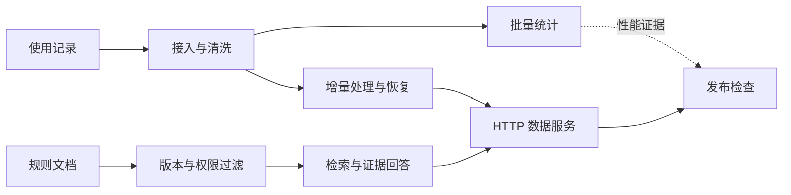

# 课程导论：从一笔订单到数据服务

同学们即使只写过一些 Python 小程序，也可以从这里开始。先不用记工具名称，我们从一次熟悉的下单过程看起。

一家校园奶茶店的小程序，最先只要做好三件事：

1. 顾客点“提交订单”；
2. 程序保存饮品、价格和下单时间；
3. 屏幕显示取单号，店员按号码制作。

保存下来的订单可能像这样：

| 取单号 | 饮品 | 金额 | 时间 |
|---|---|---:|---|
| A021 | 柠檬茶 | 12 | 11:46 |
| A022 | 奶茶 | 15 | 11:47 |
| A023 | 柠檬茶 | 12 | 11:48 |

这已经是一个普通应用：它的主要任务是完成下单业务，接收操作、保存数据，再把结果交给用户。普通应用也可以有很多用户、使用多台机器、部署在云上并提供统计；“普通”不等于结构简单或只能单机运行。

请同学们先阅读第 1—7 节，理解课程要解决的问题，再按第 8 节完成环境准备。全部必做任务使用自己的笔记本；遇到无法定位的问题时，带上命令和错误信息与授课老师讨论。

## 1. 订单变多以后，会出现什么新问题

### 店长想看一个月的经营情况

一天结束后，店长不只想看某一笔订单，还想知道：

- 今天卖了多少杯？
- 哪种饮品最多？
- 午休时段是否经常退款？

这时要把很多订单放在一起，检查缺失、重复或错误金额，再按日期和饮品统计。这是**数据处理**：把原始记录整理成可以计算、解释和复查的结果。少量数据也会有重复和错误，这些问题并不是大数据才会出现。

五家店一个月的订单通常用一台电脑和普通 SQL 就能处理。**SQL** 是从表中筛选、分组和汇总数据的查询语言。不能只因为有五家店或几万行记录，就把问题叫作“大数据”。

### 店开得更多，记录也来得更快

如果门店继续增加，历史记录保存多年，订单、退款、配送和库存又来自不同系统，一台电脑原有的做法可能逐渐无法按时完成：

- 数据装不下或计算太慢，需要把大文件分块保存、分批读取，或把任务分给多台机器；
- 新订单不断到来，结果需要持续更新；
- 某个处理任务中途失败，已经完成的工作不能全部丢失；
- 多个人和程序同时使用结果，数据版本和权限不能混乱。

人们常用“**大数据处理**”概括这类在单机方案难以满足数据规模、到达速度或完成时限时，需要组织存储和协作计算的数据工作。它没有一条适用于所有系统的行数门槛。是否需要大数据技术，要看数据量、到达速度、种类、计算时限和可靠性要求。

### 午休时很多人同时下单

午休时，很多顾客可能同时打开小程序。系统可以通过网络使用更多计算机，把图片、订单和统计放到不同的存储中，并让多个服务协作。

**云计算**可以简单理解为：通过网络按需取得和管理计算机、存储和网络资源，而不是每次都先购买、安装和维护自己的物理机器。租用一台云服务器、使用专门保存文件的服务、使用由服务商维护的数据库，都是不同的云服务。增加机器只是其中一种用途，而且程序本身还要支持并发、数据一致性和故障处理；租用了云服务器不会自动解决这些问题。

普通应用、数据处理和云计算关注的问题不同，但经常出现在同一个系统里：

| 关注点 | 奶茶店例子 | 主要问题 |
|---|---|---|
| 业务应用 | 下单、保存、显示取单号 | 一次业务操作怎样正确完成 |
| 数据处理 | 清理订单并统计销量、退款 | 多条记录怎样变成可信结果 |
| 云计算 | 通过网络取得计算、存储和服务 | 资源怎样取得、连接、扩展和管理 |

小数据应用也可以放在云上；大数据也可以在自有机房处理；多进程计算也不一定使用云。后面的实验会把这些关系逐步拆开。

## 2. 这些技术会用在哪些工作中

数据系统由不同岗位共同建设。先从他们处理的任务和交付的结果来理解工作内容；同一个岗位名称在不同单位可能有不同分工。

| 工作方向 | 日常会做什么 | 常见产物 | 本课程对应练习 |
|---|---|---|---|
| 数据开发或数据工程 | 接入、清洗和汇总分散的数据，维护批量或持续处理任务 | 数据表、处理任务、质量报告 | 实验 01—04 |
| 数据平台开发 | 建设团队共用的数据接入、处理和治理能力 | 通用管道、任务平台、数据目录 | 实验 01—05、08 |
| 后端数据服务 | 把统计和查询能力做成其他程序可调用的接口 | HTTP 网络接口、错误响应、性能记录 | 实验 06—07 |
| 云平台运维与可靠性 | 部署服务、配置监控和告警、处理故障并分析原因 | 部署配置、健康检查、监控记录 | 实验 03、04、07—08 |
| AI 应用数据工程 | 整理知识资料、检索证据、评价生成结果 | 检索索引、引用、测试集、评价报告 | 实验 05—06 |

例如，大数据开发工程师会把订单、用户行为或服务记录接入数据仓库，清洗并整理成稳定的指标和数据集，再检查处理任务是否按时、按质完成。数据平台工程师建设团队共用的数据接入、转换和治理能力。站点可靠性工程师常简称 **SRE**，关注服务能否持续运行，会配置监控和告警、处理故障并用自动化减少重复工作。

把工作放进一天的任务中，会更容易理解：

- 电商数据开发人员把订单和退款记录整理成昨日销售表，常用 SQL 和 Python；数据量很大时可能用 Spark 分担计算。
- 物流实时数据开发人员持续接收“包裹已扫码”“车辆已到站”等事件，用 Kafka 和 Flink 一类工具更新包裹状态。
- 云运维或 SRE 发现接口变慢后查看监控指标和日志，定位故障并恢复服务，常接触 Linux、容器和监控工具。

查找实习或岗位说明时，可以使用“数据开发 / 大数据开发 / 数据工程师”“实时计算 / 数据平台开发”“云运维 / SRE”等关键词。下节会说明这些工具各自解决什么问题。

岗位名称和工具会随单位变化。阅读岗位说明时，可以重点看它要求交付什么：是一段 SQL、一个处理任务、一套数据质量规则、一个服务接口，还是一次故障恢复方案。

如果以后介绍自己的课程练习，可以准确写出做过的操作，例如“在本机完成对象接口、分层数据、多进程计算、事务恢复和 HTTP 服务”，再展示代码和结果。

## 3. 数据系统里常用哪些工具

真正的数据平台通常由多个部分合作完成。先看每一部分解决什么问题，再看工具名称。

| 要解决的问题 | 生产系统中的常见工具和做法 |
|---|---|
| 保存大量原始文件 | S3 一类对象存储，把完整文件作为对象保存 |
| 组织原始、清洗和分析结果 | 数据湖分层、Parquet 列式文件、Iceberg 等表格式 |
| 查询和核对表格数据 | SQL 查询引擎或数据仓库 |
| 将批量计算拆开执行 | Spark 等把任务分给多台机器的计算引擎 |
| 持续接收事件并在失败后继续 | Kafka 等事件队列配合 Flink 等流处理引擎 |
| 安排任务先后、定时和重试 | Airflow 等任务调度工具 |
| 提供接口并持续运行 | HTTP 服务、容器、日志、指标和告警 |

生产系统通常还要处理多台机器失联、身份和权限、容量规划、持续发布与团队协作。本课程把其中几项缩小到一台电脑，选择每个工具都有具体目的：

| 本课程工具 | 选择它做练习的原因 |
|---|---|
| Moto | 不注册云账号也能通过网络发送真实 S3 请求，观察桶、对象键、上传和下载 |
| Parquet + DuckDB | 文件直接保存在本地，DuckDB 可以用 SQL 查询 Parquet，容易核对列、行数和结果 |
| Dask LocalCluster | 在一台电脑上启动多个独立工作进程，看见分区、调度、数据交换和启动开销 |
| SQLite | Python 可直接使用一个本地数据库文件，不安装独立数据库服务也能观察事务、检查点和重放 |
| TF-IDF 或 BM25 关键词排序 + BGE 语义编码器 | 在同一批规则上比较关键词权重和可选的语义向量，结果可以逐条回到原文 |
| FastAPI | 用少量 Python 代码建立带参数检查的 HTTP 接口，便于从另一个终端真实调用 |
| SHA-256 清单 | 用内容摘要连接输入、输出和版本，文件变化时能发现旧结果 |

第一次出现的几个词，可以先这样理解：

- **对象存储**把完整文件当作对象保存。“桶”像装文件的容器，“对象键”像文件在容器里的名字，两者合起来就能找到对象。S3 API 是一组常见的对象存储操作接口。
- **数据湖**保存原始数据和多种处理结果。课程使用 raw、silver、gold 三层：原始、清洗后、可直接分析或服务。
- **Parquet**是一种按列组织的数据文件。例如统计订单总额时只需读取“金额”列，不必把饮品名称等列全部读入。
- **批处理**一次处理一份边界明确的数据；**流处理**面向持续到达的事件。
- **事务**让一组数据库修改一起成功或一起撤销；**检查点**记录已经可靠处理到哪里。
- **HTTP 服务**让浏览器或其他程序通过网络发送请求并接收响应。
- **TF-IDF** 和 **BM25** 是两种按查询词与文档词语关系排序的方法；课程基础路径选择其中一种即可。

请按第 8 节准备实验环境，后续手册将使用上表中的课程工具。阅读生产系统资料时，可以对照它们解决的问题，理解不同工具的适用场景。

## 4. 本课程分析什么

下面用模拟的服务调用记录开展实验。每条记录描述一次请求的时间、输入量、输出量、耗时和状态，可以像订单一样进行校验、分组和统计。

同学们在本人笔记本上运行 `coursekit seed` 生成数据，随后使用本机的 Python 程序、数据文件和 HTTP 服务完成实验。这个案例称为“模拟服务使用分析与规则查询平台”。

规则文档中的 `public` 和 `internal` 是模拟的可见性标签。实验用它们检验同一个查询在不同角色下能否读取相应资料。

课程以使用记录和规则文档为输入，逐步完成统计、查询、服务和发布检查。

先看一条使用记录中最容易理解的内容：

| 记录编号 | 时间 | 服务 | 输入量 | 输出量 | 耗时 | 状态 |
|---|---|---|---:|---:|---:|---|
| evt-0001 | 9 月 11 日 11:48 | 文本助手 | 320 token | 86 token | 1450 毫秒 | 成功 |

例如，上表模拟一次文本助手请求，给出它的发生时间、耗时、状态和输入输出 token 数。程序中的 `assistant`、`search`、`batch` 是三种模拟业务标签，分别表示文本助手、检索和批量任务。**Token** 是模型处理文本时使用的计量单位，不等于汉字数或单词数。实验 01 再查看程序里的完整字段名和时间格式。

这些数值由脚本按固定随机种子生成。同学们要分析的是这组可重复生成的数据，并在报告中注明数据来源、规模和版本。

另一份输入是随数据生成的虚构规则文档，例如“每周可以使用多少分钟”“配额用完后怎么办”“维护信息谁能看”。每篇文档带有编号、版本、公开范围和审核状态。使用记录适合做数值统计，规则文档适合做检索和原文核对，两类数据不能混成一张表后随意计算。

## 5. 先分别做好两件事，再把结果放进一个服务

### 第一件事：统计使用记录

在模拟管理员视角下，同学们需要查看每种服务的请求数和 token 总量。处理过程是：

1. 收到原始记录，确认文件在传输后没有改变；
2. 找出缺字段、负数、错误时间和重复事件；
3. 保存合法记录，同时保留被拒绝记录及原因；
4. 对历史数据做批量统计；
5. 新记录到来或任务中断时，从可靠位置继续处理。

最终 `/stats` 响应包含工具名称、数据版本和各服务统计。下面先用三类服务各有少量调用的假设数据，看看其中 `rows` 是什么样；这些数字只用于说明表格：

| 服务 | 请求数 | 输入 token | 输出 token |
|---|---:|---:|---:|
| 文本助手（assistant） | 8 | 2560 | 680 |
| 批量任务（batch） | 2 | 1400 | 210 |
| 检索（search） | 5 | 900 | 120 |

上表用三行简单数字说明输出字段，不是实验的预期答案。实验报告要引用自己运行得到的结果和 `data_version`；这个字段是本次统计数据内容的版本标识。

### 第二件事：查阅规则

用题集中的问题“模拟服务的用户每周 CPU 推理配额是多少分钟？”检验规则查询时，系统需要先做四项检查：

1. 只使用当前版本且已经批准的规则；
2. 先按用户可见范围过滤，不能让公开查询看到内部资料；
3. 找到相关原文，并保留文档编号、版本和位置；
4. 没有足够证据时明确拒答，不根据常识补写题设之外的规则。

默认基础路径直接返回两条证据摘录。下面是虚构语料中 `quota` 文档第 2 版的一段内容，供同学们核对检索结果：

> 模拟服务的用户配额：每个用户每周有 120 分钟 CPU 推理时间。配额在周一零点重置，超出配额的任务进入等待队列。
> 来源：配额规则 `quota` 的第 2 版。实际响应还会给出原文片段的位置。

实际 `/ask` 响应还包含查询角色、是否拒答、命中文档、引用、数据版本和索引版本。**索引**是为了快速查找规则而整理的目录，作用像书后的关键词索引；索引版本说明这次查询使用的是哪一版目录。这里最重要的不是句子是否流畅，而是读者能否回到原文，确认版本、权限和内容。

### 两条结果在服务里相遇

实验 07 把统计和规则查询放进同一个 HTTP 服务。管理员请求 `/stats` 查看统计，用户请求 `/ask` 查询规则。服务记录数据版本、索引版本、请求和错误次数、响应耗时以及缓存是否命中。

两条数据仍然保持各自来源：统计来自使用记录，规则回答来自文档。实验 05 不把实验 03 的统计表送进检索；它只把实验 04 统计快照的内容摘要写进索引清单，帮助后面确认两条结果属于同一次发布。



实验 08 输出 `release_ready` 和逐项 `checks`。前者表示当前证据是否满足发布条件，后者说明每一项检查通过或失败的原因。发现版本、权限或测试不一致时，正确行为是拒绝发布并保留失败项，而不是直接改写结果。

## 6. 八次实验怎样接起来

| 实验 | 本章要回答的问题 | 同学们要完成的关键操作 | 能看到的结果 |
|---|---|---|---|
| 01 云端数据接口与可复现环境 | 文件经过对象接口后还是同一份吗？ | 上传、下载、比较 SHA-256 内容摘要 | 对象键、原始与下载摘要 |
| 02 数据湖与质量契约 | 坏值和重复会怎样带偏统计？ | 校验、隔离、去重、写 Parquet | 数量守恒、拒绝原因、分层数据 |
| 03 分布式批处理与性能分析 | 什么时候值得把计算拆给多个进程？ | 用 Dask 多进程聚合，再和 DuckDB SQL 对照 | 进程编号、统计结果、计时与倾斜 |
| 04 增量事件处理与故障恢复 | 重发和中断后怎样继续？ | 用 SQLite 事务保存事件和检查点，再重放 | 回滚状态、恢复结果、增量汇总 |
| 05 规则文档整理与可解释检索 | 怎样只找当前且可见的规则？ | 处理版本和权限，建立关键词索引；可选 BGE | 命中的原文、文档版本和位置 |
| 06 证据查询与结果评价 | 怎样回答、拒答并检查依据？ | 测门槛、引用和测试题；可选 Qwen | 摘录或生成回答、逐题评价 |
| 07 数据服务部署与可观测性 | 其他程序怎样调用这些结果？ | 启动 FastAPI 服务，发送 HTTP 请求并测量 | `/stats`、`/ask`、延迟和错误 |
| 08 数据治理与可信发布 | 当前结果可以发布吗？ | 核对来源、版本、权限、恢复和测试证据 | `release_ready` 和逐项 `checks` |

其中有两种关系：

- **文件依赖**：后一实验直接读取前面生成的文件。例如实验 03 读取实验 02 的 Silver Parquet。
- **知识依赖**：后一实验使用前面学过的判断方法，但不直接读取其文件。例如实验 05 不读取实验 03 的批量结果，却继续使用版本和证据意识。

每次实验都采用同一学习节奏：先对小例子作预测，运行已有脚手架，查看关键字段，完成一处局部代码改动，再用正常、错误或边界输入核对。同学们不需要从空白写出整个系统，但要能解释自己改了什么、为什么这样改、结果怎样支持判断。

## 7. AI 在课程中可以放在哪里

这里有两件不同的事：

- **AI 助手**是同学们学习时可以自愿使用的工具，可以帮助解释配置、报错和代码。使用时要核对建议，并在报告中简短说明用途。
- **系统模型**是实验 05、06 可以实际运行的本地模型，用来比较检索和生成流程。

实验 05、06 提供两条路径供同学们选择：关键词检索加确定式原文摘录，以及 BGE 检索加本地 Qwen 生成。两条路径都检查版本、权限、引用和评价，按各自评分标准都能获得满分。

| 实验 | 模型路径做什么 | 同分基础路径做什么 |
|---|---|---|
| 05 | BGE 把规则片段和问题转换成数字向量，再按相似程度排序 | 选择 TF-IDF 或 BM25 一种关键词方法，分析成功和失败查询 |
| 06 | Qwen 依据检索到的规则，生成一段自然语言解释 | 直接列出相关原文，比较单来源、多来源和拒答情况 |

**BGE**是检索编码器，只负责把文本转换成便于比较的向量，不写答案。**Qwen**是生成模型，负责根据已有证据组织文字。希望“额度用完了怎么办”靠近“配额耗尽后的处理办法”，是 BGE 的作用示例；实际是否命中要看运行结果。

模型生成不流畅或遗漏条件时，仍可以把它作为分析材料。请指出哪句话有原文支持、哪句话矛盾或没有依据，并继续核对数据、权限和版本。证据不足的回答不能发布，应拒答或回到原文摘录。

## 8. 环境准备与国内下载

### 8.1 先准备基础环境

如果电脑还没有 Python 3.12，先按 [Windows 环境准备](../docs/Windows环境准备.md)完成安装。把课程包放在短路径，例如 `C:\BDP`；能看到 `coursekit` 文件夹和 `requirements.lock.txt` 的目录就是课程根目录。在这个目录打开 Windows PowerShell。清华 PyPI 镜像只用于本次安装，不修改电脑的全局配置：

```powershell
$coursePyPI = 'https://mirrors.tuna.tsinghua.edu.cn/pypi/web/simple'
py -3.12 -m venv .venv
.\.venv\Scripts\python.exe -m pip install --index-url $coursePyPI -r .\requirements.lock.txt
```

如果已在自己的笔记本上缓存了离线依赖包 `wheelhouse`，先按 [Windows 环境准备](../docs/Windows环境准备.md)核对文件清单，再使用该文档中的离线安装命令。不要临时改用来源不明的安装包。

基础路径准备到这里即可。执行 `pip check` 确认已安装软件包之间没有依赖冲突：

```powershell
.\.venv\Scripts\python.exe -m pip check
```

### 8.2 选择模型路径时再准备本地模型

实验 05 使用 `BAAI/bge-small-zh-v1.5` 检索编码器。实验 06 的默认生成模型是 Qwen3.5 0.8B Q8_0。选择模型路径的同学再安装模型依赖和 Ollama；基础路径不需要这些步骤。

Ollama 是在本机运行模型并提供 HTTP 接口的程序。按 [Windows 环境准备](../docs/Windows环境准备.md)中的步骤安装；若暂时无法下载安装，请先完成同分基础路径；已有官方离线安装文件时，核对来源后再使用。

```powershell
.\.venv\Scripts\python.exe -m pip install --index-url $coursePyPI -r .\requirements-models.lock.txt
.\.venv\Scripts\python.exe -m pip check
```

准备脚本默认从国内 ModelScope 下载固定文件并核对内容。生成模型来自 [ModelScope 的 ggml-org 转换仓库](https://modelscope.cn/models/ggml-org/Qwen3.5-0.8B-GGUF)，文件 `Qwen3.5-0.8B-Q8_0.gguf` 约 0.83 GB。

**GGUF**是本地模型运行常用的文件格式。文件名相同不代表内容一定相同，所以课程使用三种标识核对：

- `revision`：下载仓库中文件版本的标识；
- `manifest`：记录文件名、大小和 SHA-256 的清单；
- `digest`：模型导入 Ollama 后得到的内容摘要。

Ollama 中使用的本地模型名叫作 `tag`。本课程导入后的 tag 是 `bdp-qwen35:0.8b-q8_0`。它来自 ggml-org 转换的 GGUF，与 Ollama 官方模型库中的同名模型不是同一个文件，应以课程 manifest 和本地 digest 核对。

在课程根目录依次运行：

```powershell
.\.venv\Scripts\python.exe .\scripts\prepare_embedding.py
.\.venv\Scripts\python.exe .\scripts\prepare_generation.py prepare
.\.venv\Scripts\python.exe .\scripts\prepare_embedding.py --verify-only
.\.venv\Scripts\python.exe .\scripts\prepare_generation.py verify
.\.venv\Scripts\python.exe .\scripts\prepare_generation.py import-ollama
$env:BDP_EMBED_MODEL = (Resolve-Path .\models\bge-small-zh-v1.5).Path
$env:HF_HUB_OFFLINE = '1'
$env:BDP_OLLAMA_MODEL = 'bdp-qwen35:0.8b-q8_0'
```

已经拿到与课程 manifest 一致的离线文件时，BGE 可执行 `prepare_embedding.py --local-source <目录>`，GGUF 可执行 `prepare_generation.py prepare --local-file <文件路径>`，随后仍要运行校验和 Ollama 导入。同名 Safetensors 文件不能直接当作 GGUF 使用。

上述环境变量只影响当前 PowerShell 及其新启动进程。每次新开模型或语义索引服务终端，都要重新设置本地 `BDP_EMBED_MODEL`、`HF_HUB_OFFLINE=1` 和完整 `BDP_OLLAMA_MODEL`，不能仅在下载终端设置；服务也需重启后实际查询验证。

`OLLAMA_HOST` 设置 Ollama 服务地址，`OLLAMA_MODELS` 设置本地模型目录；它们都不是下载镜像变量。

### 8.3 普通笔记本怎样选择

同学们先在自己的笔记本上完成词法检索和确定式摘录。选择本地模型对照时，使用 BGE 与 Qwen3.5 0.8B Q8_0，并按下列步骤控制进程和内存占用。

实验 05 完成 BGE 编码后关闭该 Python 进程，再单独运行实验 06 的 Qwen。模型文件之外还要给运行时和系统留出内存；若等待过久或内存不足，请保留错误信息并改做词法检索和确定式摘录。

默认生成配置使用 CPU，关闭思考，上下文长度 2048，最多生成 256 token，使用 2 个 CPU 线程，请求超时 120 秒，`temperature=0`。第一次运行保持默认即可。比较两条路径时，使用同一台电脑、相同问题和评价方法，记录耗时、内存和答案差异；不把不同设备的数据直接换算成速度倍数。

模型生成可能遗漏条件或给出错误引用，请逐条核对原文。小模型能运行只说明接口可用，不能据此认定回答质量合格。

## 9. 开始实验前检查一次

读完这份导论后，试着不用术语回答四个问题：

1. 一个下单应用、一次订单统计和租用云服务器分别关注什么问题？
2. 课程案例为什么同时需要使用记录和规则文档？
3. 实验 03 和实验 05 为什么属于两条不同输入路线？
4. 关键词摘录路径与 BGE/Qwen 路径分别会产生什么证据？

开始实验 01 前，再确认：

- 能在课程根目录运行 `.\.venv\Scripts\python.exe --version`；
- 基础依赖已经安装，`.\.venv\Scripts\python.exe -m pip check` 没有报告冲突；
- 选择模型路径时，模型已经下载并通过 `--verify-only` 或 `verify`；
- 能找到课程根目录，并知道各实验结果按对应实验手册保存。

实验 01 开始时登记本人学号，后续每章沿用本人身份并使用对应实验的两位编号。按 [学号与提交验收](../docs/学号与提交验收.md) 保存自动生成的运行 JSON/HTML；自写脚本和观察命令可用 capture 留证。所有评分截图都须原生显示学号、本章实验/项目号、run_id 与真实结果，失败和恢复同样适用。报告首页或另外一张学号图不能替代结果画面的身份；授课老师逐张复核，缺失、不一致或未复核不能通过。报告正文写学号，HTML/同名 JSON 和原始文件/旁证成对提交，最后生成提交清单。

遇到问题时，先记录正在运行的命令、工作目录、第一条错误和已经生成的文件。这样更容易判断是下载、环境、输入、代码还是服务问题。

## 10. 延伸阅读

下面的官方资料可帮助同学们进一步了解岗位任务和生产系统。请结合感兴趣的实验主题查阅。

岗位任务示例：

- [腾讯：微信基础—大数据工程师—AI 方向](https://careers.tencent.com/jobdesc.html?postId=2059948187954888704)：实时与离线指标、数据仓库、数据平台和处理流程。
- [Apple：Data Platform Engineer](https://jobs.apple.com/en-us/details/200669525-1052/data-platform-engineer?team=SFTWR)：数据接入、通用转换、治理和分布式数据系统。
- [Apple：Site Reliability Engineer](https://jobs.apple.com/en-us/details/200647012-1052/site-reliability-engineer)：云基础设施、自动化、监控和故障处理。

架构与工具：

- [NIST SP 800-145：云计算定义](https://csrc.nist.gov/pubs/sp/800/145/final)：按需网络访问、共享资源池以及资源分配和释放。
- [Microsoft Fabric：Medallion Architecture](https://learn.microsoft.com/zh-cn/fabric/onelake/onelake-medallion-lakehouse-architecture)：原始、清洗和分析数据的分层思路。
- [AWS：Modern Data Architecture](https://docs.aws.amazon.com/wellarchitected/latest/analytics-lens/modern-data-architecture.html)：数据湖、专用存储、数据移动和治理的协作。
- [Apache Iceberg Specification](https://iceberg.apache.org/spec/)：用元数据、清单和快照管理分布式存储中的数据文件。
- [Apache Kafka Introduction](https://kafka.apache.org/intro/)：持续写入、保存和分发事件。
- [Apache Flink Fault Tolerance](https://nightlies.apache.org/flink/flink-docs-stable/docs/learn-flink/fault_tolerance/)：状态、检查点和重放。
- [Apache Airflow Documentation](https://airflow.apache.org/docs/apache-airflow/stable/index.html)：任务依赖、运行状态、日志、回填和重跑。
